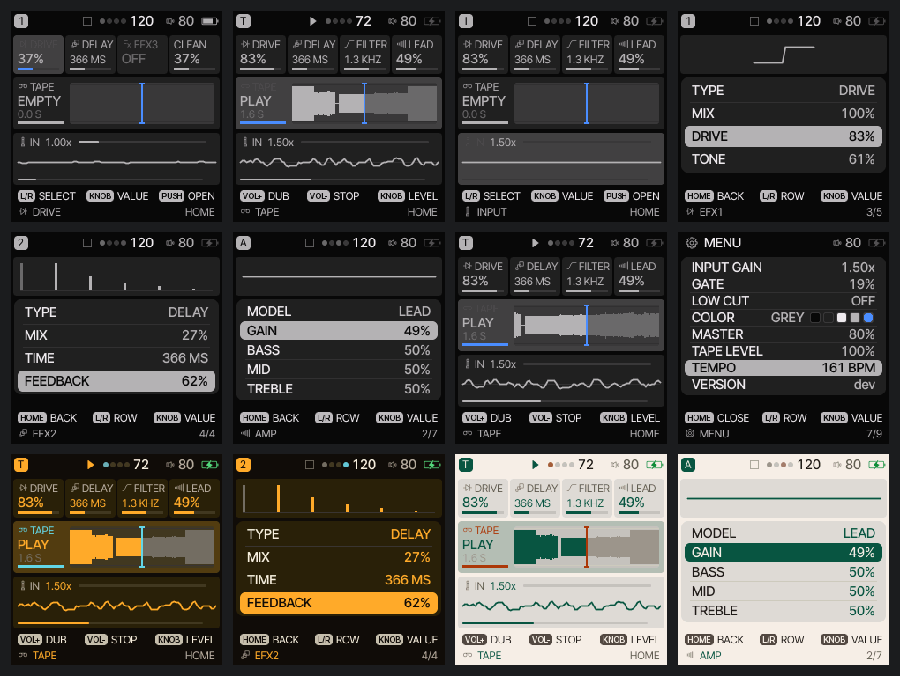

# Pendel

[](LICENSE)



## Overview

Pendel is open-source firmware for the M-VAVE Pocket AMP: an effects unit with a tape loop.

**Beta.** This is a beta version: the first full release may change a great deal (the effects, the controls and the
screen).

```
IN → EFX1 → EFX2 → EFX3 → AMP → TAPE
```

- **EFX1–3**: drive, fuzz, filter, auto-wah, crush, phaser, flanger, tremolo, wobble, pitch, delay, room, noise, gain
- **AMP**: clean, crunch or lead, with bass, middle, treble and a cabinet
- **TAPE**: a 9-second looper on VOL+ (record, overdub) and VOL- (stop, hold to clear); it also sets the tempo
- **METRONOME** (MENU): a click at the tempo, 1–8 beats to the bar, an accent on the first, its own level
- **TUNER** (push on HOME's IN, or MENU): the note, the octave and the cents, E1 to E6 and beyond; the sound goes on through it

A sibling of [Felucca](https://github.com/hugelton/Felucca) (the M-VAVE FM-1 firmware), on the same chip and the same
look. Hardware layer: [pendel-bsp](https://github.com/hugelton/pendel-bsp) (MPL-2.0).

The Pocket AMP firmware is at version 1.0.2 beta. Connect the Pocket AMP to a computer by USB, open the [web
installer](https://hugelton.github.io/Pendel/) in Chrome or Edge and press Install; no extra hardware is needed.
Installing is at your own risk: the installer's **Return to the official firmware**, with the official file from
M-VAVE, takes you back.

- Install: [web installer](https://hugelton.github.io/Pendel/), or `tools/pa_install.py` ([BUILDING.md](BUILDING.md))
- Build: [BUILDING.md](BUILDING.md)
- Try: the browser simulator in `sim/`

## Platform Support

| Platform | Status | Notes |
| --- | --- | --- |
| M-VAVE Pocket AMP | Beta | 1.0.2 beta; firmware and [web installer](https://hugelton.github.io/Pendel/) available. |
| Browser | In progress | The simulator in `sim/`. |

## AI disclaimer

Pendel is developed with the assistance of AI coding agents (code, tests, documentation, maintenance). The design,
features, sound design and direction are the maintainer's, and no generative AI is used for music, icons or artwork.
See [On AI-Assisted Development and Responsibility](https://github.com/hugelton/Felucca/discussions/166).

## Credits and licence

[GPL-3.0-only](LICENSE); pendel-bsp is MPL-2.0; the bundled fonts keep their own licences ([LICENSING.md](LICENSING.md)).
Thanks: [CREDITS.md](CREDITS.md).

M-VAVE and Pocket AMP are trademarks of their respective owners. Pendel is not affiliated with or endorsed by them.

Copyright (C) 2026 Leo Kuroshita (@kurogedelic), Hügelton Instruments
